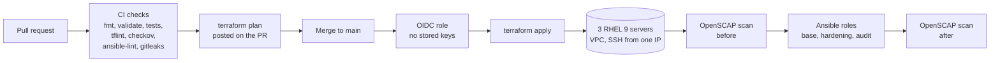

# Hardened RHEL fleet

[](https://github.com/melhyboris/hardened-rhel-fleet/actions/workflows/ci.yml)

Terraform builds three RHEL 9 servers on AWS, Ansible hardens them against the CIS Server Level 1
profile, and OpenSCAP measures the result before and after. Every infrastructure change goes
through a pull request, and GitHub Actions deploys with short-lived OIDC credentials, so no AWS
keys are stored anywhere.

> Personal lab project, built on my own AWS account. Nothing here comes from an employer.

## Result

<!-- Replace this block with the output of `make score` after your own run. -->

| Server | Before | After | Change |
| --- | --- | --- | --- |
| hardened-rhel-fleet-01 | _run `make score`_ | | |
| hardened-rhel-fleet-02 | | | |
| hardened-rhel-fleet-03 | | | |

Demo video: _add your link here_

## How it works



| Layer | What is in the repo |
| --- | --- |
| `bootstrap/` | One-time Terraform: S3 state bucket, GitHub OIDC provider, a read-only plan role and a deploy role |
| `terraform/` | VPC, subnet, security group (SSH from one address), three encrypted IMDSv2-only instances, and tests that run against a mocked provider |
| `ansible/` | Dynamic inventory by tag, three roles (`base`, `hardening`, `audit`), a scan playbook, post-reboot verification |
| `.github/workflows/` | `ci` on pull requests, `deploy` on merge to main, `destroy` on demand |
| `scripts/`, `tests/` | Before/after score table and its unit tests |

## What the hardening role does

- **Access:** key-only SSH, no root login, no forwarding, idle timeouts, login banner, sudo logging
- **Network:** firewalld default zone `drop` with only SSH allowed, redirects and source routing off, reverse-path filtering, SYN cookies
- **Kernel:** ASLR, restricted `dmesg` and `ptrace`, no core dumps, unused filesystem and protocol modules blocked
- **Accounts:** password length, complexity, aging and history; lockout after 5 failed attempts
- **Integrity and audit:** SELinux enforcing, auditd rules for identity, time, permissions, mounts, sudo and kernel modules (locked until reboot), daily AIDE check
- **Rollout:** one server at a time, reboot, then assert that SELinux, SSH and the firewall came back as intended

## Quick start

Needs Terraform 1.10+, Ansible, the AWS CLI with credentials, and an SSH key. The full walkthrough
is in [docs/STEP_BY_STEP.md](docs/STEP_BY_STEP.md).

```bash
cp bootstrap/terraform.tfvars.example bootstrap/terraform.tfvars   # set your GitHub user
cp terraform/terraform.tfvars.example terraform/terraform.tfvars   # set your IP and public key
make bootstrap init apply      # state bucket, OIDC roles, then the fleet
make ping scan-before          # baseline
make harden scan-after score   # harden, measure, print the table
make destroy                   # stop the charges
```

## Cost

Three `t3.small` instances and three 20 GB volumes. RHEL images add Red Hat's hourly fee; set
`os = "alma9"` to avoid it. Check current prices for your region, set a budget alert, and run
`make destroy` when you finish a session.

## Lessons and next steps

<!-- Write two or three honest lines after your own run: what broke, what you changed. -->

- Move the servers to a private subnet and reach them through SSM Session Manager instead of public SSH
- Run the Ansible play from CI through SSM, so hardening also deploys on merge
- Close the remaining findings from the after-scan, or record why each one is accepted
- Add CIS Level 2 and DISA STIG profiles as scan options
